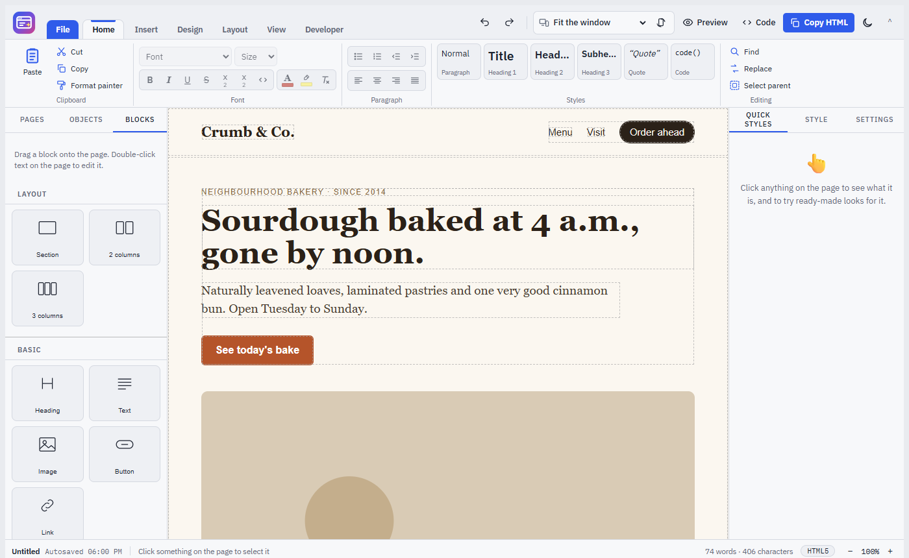
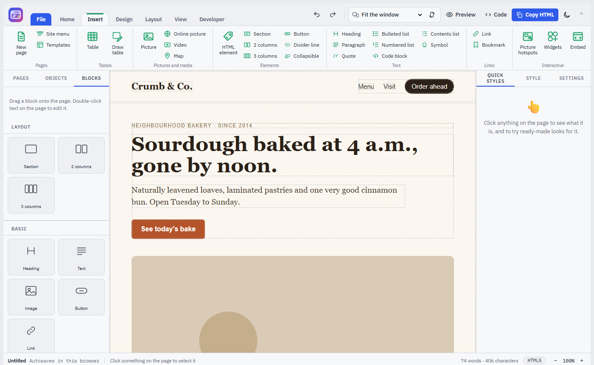
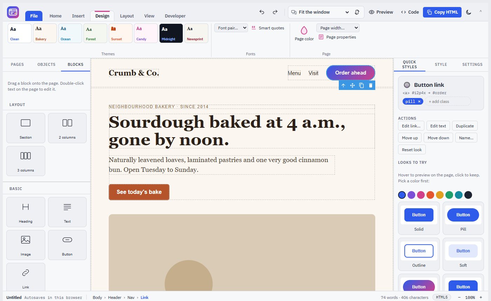
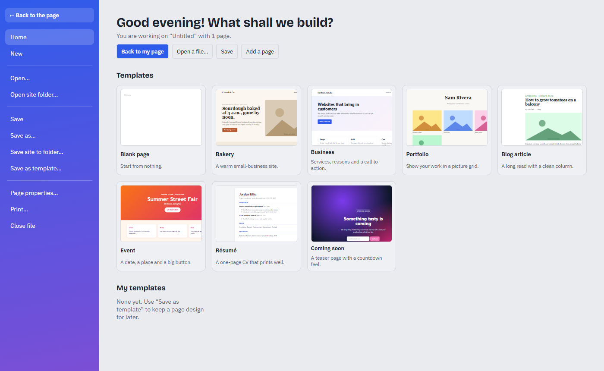
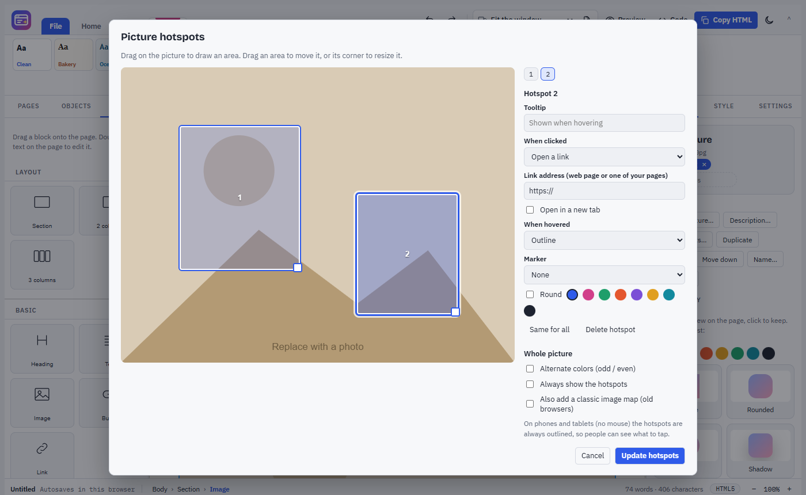

# SiteCraft

**A website builder that feels like a word processor. It runs in your browser, fully offline.**

Build pages the way you write documents: a ribbon of clearly labelled tools, a styles gallery, tables you can draw, find and replace, and right-click menus. Under the hood it is a real web builder (built on [GrapesJS](https://grapesjs.com/)): drag blocks, style anything, preview on dozens of phones and tablets, build multi-page sites, and save clean `.html` files.

Ideas are borrowed from the open-source editors **Quill**, **Tiptap** and **Jodit**, from Word's ribbon as reimagined by **[WordCraft](https://github.com/storytold/wordcraft)**, and from desktop tools like **CoffeeCup**.



## Getting started

1. Download this repository (green **Code** button › **Download ZIP**) or clone it.
2. Double-click **`index.html`**. It opens in Chrome or Edge.
3. Click the **File** tab for the start page: pick a template, or keep editing the bakery starter page.
4. Click anything on the page and use the ribbon, or the **Quick styles** panel on the right, to change it.
5. **File › Save** saves the page as an `.html` file. **Save site to folder** saves every page of a multi-page site.

Your work also autosaves in the browser.

## Finding your way

| Where | What is there |
| --- | --- |
| **SiteCraft logo** (top left) | Every command in classic menus: File, Edit, View, Insert, Format, Table, Help (also F10) |
| **Ribbon tabs** | File, Home, Insert, Design, Layout, View, Developer, and **Table** while you work in a table. Each tab has its own color. |
| **Top right** | Undo, redo, screen size, Preview, Code, Copy HTML, light/dark |
| **Left panel** | **Pages** (your site), **Objects** (everything on the page, nested), **Blocks** (drag onto the page) |
| **Right panel** | **Quick styles**, **Style** (every CSS setting), **Settings** (links, alt text, ids) |
| **Status bar** | File name and autosave, the selected object's path, word count, the HTML standard in use, zoom |

Right-click anything on the page for a menu. Double-click a ribbon tab to hide or show the buttons.

## The ribbon



- **Home:**
  - **Clipboard:** paste, cut, copy, format painter.
  - **Font:** font, size, bold, italic, underline, strikethrough, subscript and superscript, inline code, font and highlight colors, clear formatting.
  - **Paragraph:** lists, indent, alignment.
  - **Styles:** a gallery with Normal, Title, Heading, Subhead, Quote and Code.
  - **Editing:** find, replace, select parent.
- **Insert:**
  - **Pages:** new page, site menu, templates.
  - **Tables:** pick a size, or **Draw table**.
  - **Pictures and media:** pictures from your computer or the web, video, map.
  - **Elements:** **any HTML element** from a searchable list, sections, columns, buttons, dividers, collapsibles.
  - **Text:** headings, paragraphs, lists, quotes, code blocks, a contents list, symbols and emoji.
  - **Links:** links and bookmarks.
  - **Interactive:** **picture hotspots**, **widgets** and embeds.
- **Design:**
  - **Themes:** Clean, Bakery, Ocean, Forest, Sunset, Candy, Midnight, Newsprint.
  - **Fonts:** font pairs, smart quotes.
  - **Page:** page color, page width, page properties (title, description, language).
- **Layout:**
  - **Spacing:** padding, margin, width.
  - **Position:** move the block left, center or right.
  - **Columns:** stacked, 2 or 3 columns.
  - **Arrange:** move up or down, duplicate, delete.
  - **Show on:** hide an element on computers, tablets or phones.
- **View:**
  - **Screens:** computer, tablet, phone, sideways, more sizes.
  - **Zoom:** in, out, 100%, fit.
  - **Look:** Preview, outlines, full screen, page code.
  - **Show:** status bar, spelling.
  - **Panels** and the **light/dark theme**.
- **Developer:**
  - **Code:** edit the page's HTML and CSS, or one element's HTML.
  - **Add-ons:** libraries, widgets, page script.
  - **Compatibility:** pick the mode, check the page.
  - **Check:** accessibility check, preview in browser.
- **Table** (appears in a table):
  - **Rows and columns:** insert above, below, left or right.
  - **Delete** a row, a column or the table.
  - **Merge** right or down, and **split** cells again.
  - **Table style:** heading row, striped rows, borders as a grid, lines only or none.

## Quick styles: try looks on anything



Click any object to see what it is, its tag and classes (add or remove them), and actions that fit it. Below that is a gallery of **looks made for that kind of object**:

| Object | Looks |
| --- | --- |
| Buttons | Solid, pill, outline, soft, gradient, raised, dark, text link, bigger, smaller, full width |
| Pictures | Square, rounded, circle, shadow, photo print, frame, black and white, old photo, full width, thumbnail |
| Headings | Accent color, underlined, highlighter, spaced capitals, gradient, light and large, centered |
| Text | Intro text, fine print, small label, note box, warning box, quote, two columns |
| Sections and boxes | Light, accent, dark and gradient bands, card, rounded panel, narrow center |
| Lists, links, form fields, menus, tables | Their own sets |

**Hover a look to preview it on the page, and click to keep it.** Pick an accent color first to try every look in that color. Ctrl+Z undoes.

## Sites with several pages

- **Pages** panel: add, rename, duplicate and delete pages. The first page is the home page (`index.html`).
- **Insert › Site menu:** a navigation bar listing every page. It updates itself when pages are added, renamed or removed, marks the current page, and can go on every page at once. New pages get it automatically.
- **Ctrl+click** a link to one of your pages to open that page in the editor.
- **File › Save site to folder** writes every page; **Open site folder** reads a folder of pages back.

## Templates and the start page



Eight built-in templates (blank, bakery, business, portfolio, blog article, event, résumé, coming soon) with live thumbnails. **Save as template** keeps any page design for later (stored in your browser). Use a template to replace the current page or add it as a new page.

## Picture hotspots



Draw areas on a picture that react to the mouse:

- **When clicked:** open a link (your pages or any web address), show a note in a bubble, or jump to a bookmark.
- **When hovered:** outline, color tint, glow or grow, plus an optional tooltip.
- **Markers:** a pulsing dot or a number. Shapes are rectangles or circles, and every hotspot has its own color, or alternating odd/even colors.
- **Responsive:** hotspots work on every screen size, and they are always outlined on touch screens so people know where to tap.
- **Old browsers:** you can also add a classic `<map>` image map.

## Writing tools (from Quill, Tiptap and Jodit)

- Select words to format just them, or click an element to format all of it.
- **Paste from Word and Google Docs** comes in clean (bold, italic and links kept, the clutter removed). **Ctrl+Shift+V** pastes plain text.
- **Find and replace** (match case, whole words), **smart quotes and dashes**, **table of contents** from your headings, **symbols and emoji**, **format painter**, word and character count.
- **Draw table:** drag a box on the page and the table fills it.

## Screens, standards and checks

- **More than 30 screen sizes:**
  - **Computers:** 1280 × 800 up to Quad HD.
  - **Phones:** iPhone SE / 13 mini / 15 / 15 Plus / 16 Pro Max, Samsung Galaxy S24 / S24+ / S24 Ultra / A55 / Z Fold / Z Flip, Google Pixel 8 / 8 Pro / 9 Pro XL.
  - **Tablets:** iPad mini / Air / Pro, Samsung Galaxy Tab S9 / S9 Ultra / A9+, Surface Pro.
  - Turn any phone or tablet sideways. Wide screens are shrunk to fit.
- **Compatibility modes:** HTML5, XHTML 1.0 Strict, XHTML 1.0 Transitional, HTML 4.01.
  - SiteCraft writes the matching doctype and tag style.
  - **Check page** lists anything the chosen standard does not support.
  - The mode in use shows in the status bar.
- **Accessibility check:** missing picture descriptions, empty links and buttons, skipped heading levels, unlabelled form fields, duplicate ids, and weak text contrast.
- **Widgets:** picture slider, lightbox gallery, tabs, accordion, back-to-top button, countdown timer, pop-up window, typing text, reveal on scroll, current year, smooth scrolling.
  - Their small scripts were written for SiteCraft (MIT) and are added to the saved page automatically.
- **Libraries:** Bootstrap, Bulma, Pico, Normalize, Animate.css, Font Awesome, Bootstrap Icons, jQuery, Alpine.js, AOS, GSAP, Chart.js, Leaflet, Swiper.
  - They load from cdnjs or jsDelivr when the page is viewed, so they need an internet connection.
  - CSS libraries also show in the editor.
- **Preview in browser** opens the real saved page in a new tab, with scripts running.

## Keyboard shortcuts

| Action | Keys |
| --- | --- |
| Menus | F10 |
| Open / Save / Save as | Ctrl+O / Ctrl+S / Ctrl+Shift+S |
| Print | Ctrl+P |
| Undo / Redo | Ctrl+Z / Ctrl+Shift+Z |
| Find / Replace | Ctrl+F / Ctrl+H |
| Bold / Italic / Underline | Ctrl+B / Ctrl+I / Ctrl+U |
| Subscript / Superscript | Ctrl+= / Ctrl+Shift+= |
| Link | Ctrl+K |
| Heading 1–4 / Normal text | Ctrl+Alt+1–4 / Ctrl+Alt+0 |
| Bulleted list | Ctrl+Shift+L |
| Align left / center / right / justify | Ctrl+L / E / R / J |
| Paste as plain text | Ctrl+Shift+V |
| Browser spelling suggestions | Shift+right-click |
| Copy / Paste element | Ctrl+C / Ctrl+V |
| Delete element | Delete |
| Select parent / first child / next / previous | A / D / S / W |
| Leave preview, close menus, stop the format painter | Esc |

## For developers

The app is `sitecraft.src.html` (layout, styles and the core editor) plus feature modules in `js/`:

| File | What it does |
| --- | --- |
| `js/sc-ribbon.js` | The ribbon tabs, the logo menu and the top line |
| `js/sc-features.js` | HTML elements, widgets, libraries, compatibility and accessibility checks, design, layout and table tools, Draw Table |
| `js/sc-pages.js` | Pages, site menu, templates, the File start page, saving and opening site folders |
| `js/sc-quick.js` | The Quick styles panel |
| `js/sc-hotspots.js` | Picture hotspots |

The modules talk to the editor through `window.SC`. After changing anything, run:

```
python build.py
```

This writes:
- `index.html`: the offline app, using `grapes.min.js`, `grapes.css`, `fonts/` and `js/` from this folder
- `dist/artifact.html`: a single file with everything inlined except GrapesJS, which loads from a CDN

`python fetch_fonts.py` downloads the fonts into `fonts/` again if they are ever missing.

## Requirements

Chrome or Edge (recent versions) for everything, including saving straight into files and folders. Firefox and Safari work too, but download files instead.

## Credits

- [GrapesJS](https://grapesjs.com/) 0.21.13 (BSD-3-Clause)
- Feature ideas from [Quill](https://github.com/slab/quill) (BSD-3-Clause), [Tiptap](https://github.com/ueberdosis/tiptap) (MIT), [Jodit](https://github.com/xdan/jodit) (MIT) and [WordCraft](https://github.com/storytold/wordcraft) (MIT / Apache-2.0). No code was copied; the features were written for SiteCraft.
- Fonts: Bricolage Grotesque, IBM Plex Sans, IBM Plex Mono (SIL Open Font License)
